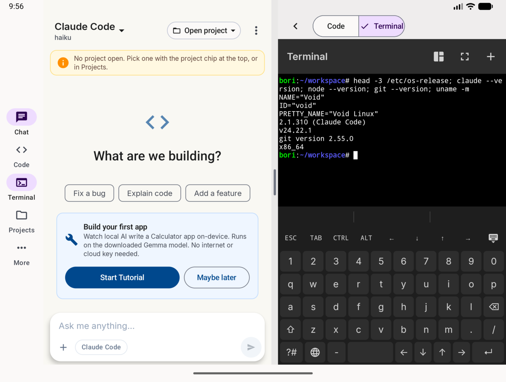
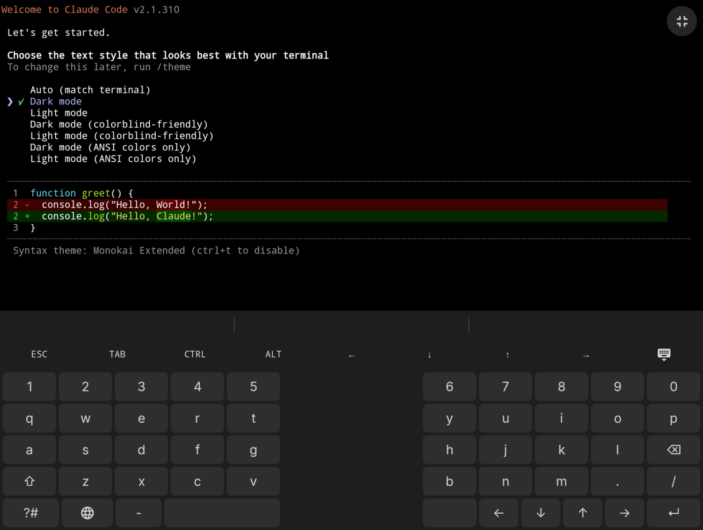
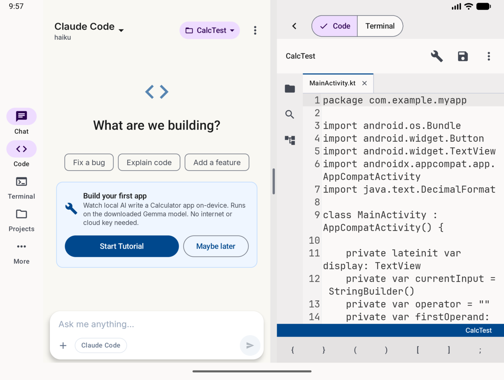
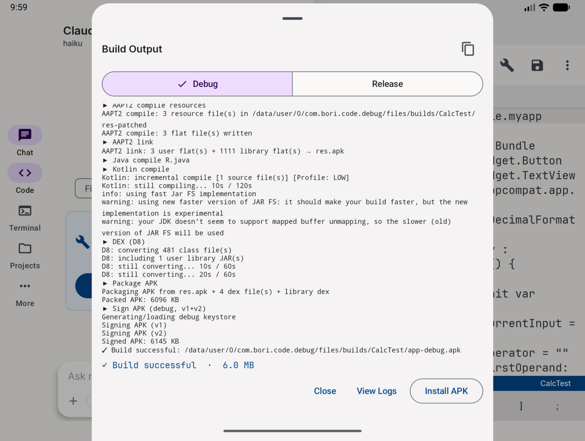
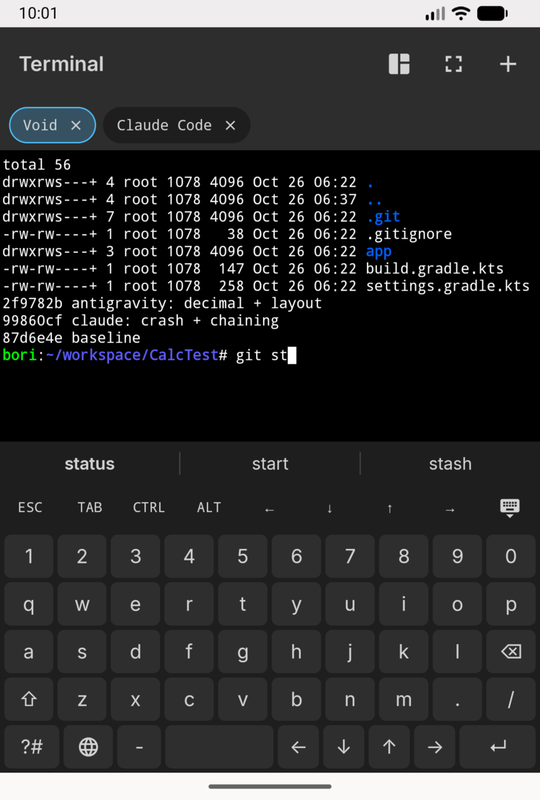
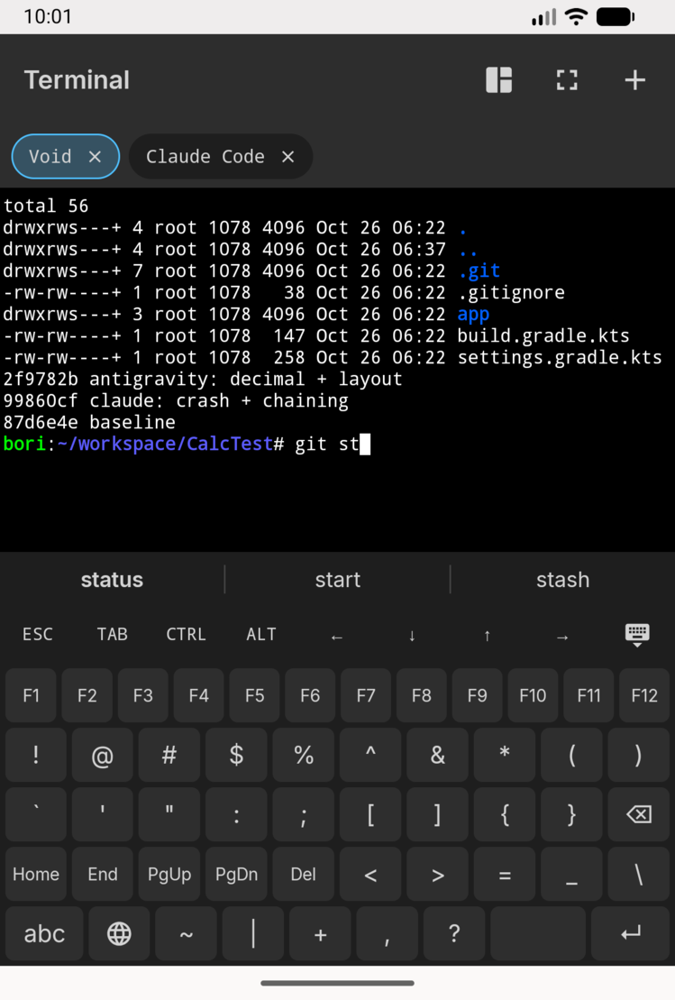
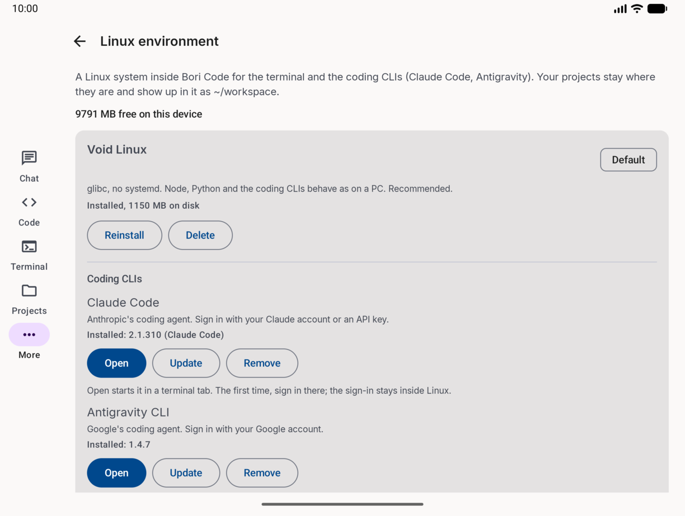
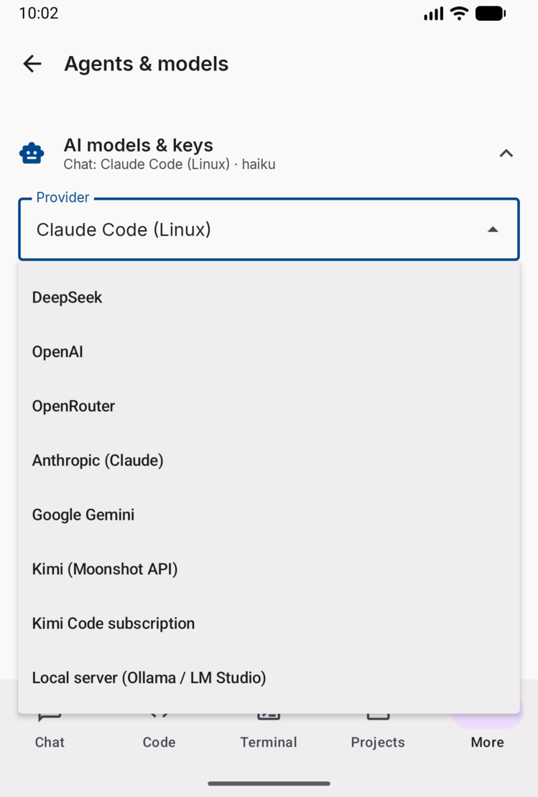

# Bori - Code

**An on-device Android IDE that builds real, signed APKs on your phone — with a
built-in, multi-provider AI coding assistant.**

Bori - Code lets you create, edit, AI-generate, **compile, sign, and install**
Android apps without a PC and without Gradle running on the device. The full build
toolchain (Kotlin compiler, Eclipse ECJ Java compiler, AAPT2, D8/R8, APK signer)
runs locally, and an AI agent can scaffold and modify your project for you.

- **applicationId:** `com.bori.code` (Play), `com.bori.code.full` (GitHub, with the Linux environment)
- **Version:** 4.2.0 (versionCode 8)
- **Supports:** Android 8.0 – 15 (minSdk 26, targetSdk 35)
- **Stack:** Kotlin · Jetpack Compose · Hilt · Room · DataStore · OkHttp
- **License:** [Apache-2.0](LICENSE). Third-party notices are in [`NOTICE`](NOTICE).


## Screenshots
| | |
|---|---|
|  |  |
|  |  |

| | | | |
|---|---|---|---|
|  |  |  |  |

**Download:** the full build (with Linux) is on [GitHub Releases](https://github.com/Atom0131/Bori-Code/releases).

---

## What it does

### 🔨 Compiles Android apps on-device (no Gradle at runtime)
A complete build pipeline packaged into the app compiles your project to a signed
APK directly on the phone:
**resolve Maven deps → AAPT2 resources → ECJ (R.java/Java) → patched Kotlin 1.8.22
compiler → D8 (debug) / R8 (release) → package → v1+v2 sign.**
See [`docs/BUILD-PIPELINE.md`](docs/BUILD-PIPELINE.md).

### 🤖 Multi-provider AI coding assistant
Chat with an AI agent that can read/write files, scaffold features, add
dependencies, edit the manifest, and trigger builds via function-calling tools.
Providers: **Anthropic (Claude), OpenAI, DeepSeek, OpenRouter, Google Gemini**, and
an **offline on-device Gemma** model with transparent fallback when you're offline.
See [`docs/AI-SUBSYSTEM.md`](docs/AI-SUBSYSTEM.md).

### ✍️ Real code editor
VS Code-style editing (Sora Editor): file tree, tabs, symbol outline, **live
diagnostics** (debounced on-device compile), find-in-files, quick-open, dependency
panel, and layout preview.

### 🐧 Linux terminal (full build only)
A real Linux (Void or Alpine, your choice) runs inside the app through proot, with
Termux's terminal and multi-pane tabs. Bori Code can install **Claude Code** and
**Antigravity CLI** in it. You sign in to them yourself, inside the CLI; Bori Code
never reads or stores their logins. The terminal has its own compact keyboard
(suggestions, swipe typing, F1–F12, arrows by Enter, a split layout when unfolded).

Google Play doesn't allow apps to download and run code like this, so the Play
build leaves it out. The full build is published on GitHub Releases.

| Build | App ID | Linux |
|---|---|---|
| `full` (GitHub Releases) | `com.bori.code.full` | ✅ |
| `play` (Google Play) | `com.bori.code` | — |

### 📦 Project management
Create Kotlin/Java projects from templates, import from ZIP, manage signing
keystores, install/launch built APKs, and use Git (JGit).

## Feature highlights
- **Plan Mode / Ask Mode** — the AI proposes a plan or asks clarifying questions
  before editing.
- **Attachments** — image vision, document text, and whole-project context.
- **Conversation compaction** — summarize long chats to free context.
- **Encrypted backup/restore** — AES-256-GCM `.mbackup` (API keys, settings, chat,
  projects).
- **Guided tutorial** — build a Calculator app with zero API key (uses on-device Gemma).
- **Obsidian Flux theme** — Material 3 light/dark, Inter + JetBrains Mono.

Full list: [`docs/FEATURES.md`](docs/FEATURES.md).

## Building from source
You need the Android SDK (platform 35, build-tools 37.0.0) and **JDK 21** (Gradle 8.11.1
doesn't run on newer JDKs). `gradle.properties` pins a Windows `org.gradle.java.home`,
so on Linux/macOS pass your own with `-Dorg.gradle.java.home=$JAVA_HOME`.
From the project root (`Bori - Code/`):
```bash
./gradlew :app:assembleDebug :app:bundleRelease      # Linux/macOS
gradlew.bat :app:assembleDebug :app:bundleRelease    # Windows
```
Outputs: `app/build/outputs/apk/{full,play}/debug/` and
`app/build/outputs/bundle/{full,play}Release/`. Release builds need your own
keystore: copy `keystore.properties.template` to `keystore.properties`.

> ⚠️ **Never run `gradlew clean`** — it deletes the patched on-device compiler
> assets and breaks all builds. Always build in the foreground. See
> [`CLAUDE.md`](CLAUDE.md) for the full contributor rules.

## Architecture at a glance
8 Gradle modules: `:app` (Compose UI + agent tools) on top of
`:core:ai`, `:core:build`, `:core:editor`, `:core:project`, `:core:security`,
`:core:terminal` (vendored Termux terminal) and `:core:linux` (proot, full build only).
Two streaming spines tie it together: the build pipeline emits `Flow<BuildEvent>`
and AI providers emit `Flow<ChatChunk>`. Details in
[`docs/ARCHITECTURE.md`](docs/ARCHITECTURE.md).

## Documentation
| Doc | Contents |
|---|---|
| [CLAUDE.md](CLAUDE.md) | Contributor onboarding + hard rules |
| [docs/ARCHITECTURE.md](docs/ARCHITECTURE.md) | Modules, data flow, streaming model |
| [docs/BUILD-PIPELINE.md](docs/BUILD-PIPELINE.md) | On-device compile pipeline |
| [docs/AI-SUBSYSTEM.md](docs/AI-SUBSYSTEM.md) | Providers, routing, models, tools |
| [docs/FEATURES.md](docs/FEATURES.md) | User-facing feature map |
| [docs/CHANGE-NOTES-2026-06.md](docs/CHANGE-NOTES-2026-06.md) | Recent changelog |

## License
Bori - Code is licensed under the [Apache License 2.0](LICENSE). The license covers
the code, not the "Bori" name or the app icon: a published fork needs its own name and
icon. Bundled third-party software keeps its own license; see [`NOTICE`](NOTICE) and
[`third_party/README.md`](third_party/README.md) (proot is GPL-2.0, and its source
ships with every full release).
